# Maintaining Permiscope

This document describes how changes are proposed, reviewed, released, and supported.
It applies to maintainers and to AI assistants working in this repository. Contributors
should start with [CONTRIBUTING.md](./CONTRIBUTING.md).

## Principles

1. **Security fixes outrank features.** A guardrail bypass is a release blocker.
2. **Fail closed.** When policy, identity, or logging state is uncertain, deny the action.
3. **Cooperative security, honestly stated.** Permiscope is not a sandbox — see
   [limitations](./docs/limitations.md). Never claim otherwise in docs or marketing.
4. **No breaking changes in a minor release.** Deprecate first, remove in a major.
5. **Every change is reviewable.** Small PRs, clear rationale, reproducible tests.
6. **No issue closes without extensive testing.** A regression test, boundary and
   failure-path unit tests, integration tests wherever a boundary is crossed, and green
   CI. "Works on my machine" is not evidence.
7. **Every line must be logical and efficient.** Choose the simplest correct solution
   that handles the edge cases; prefer the standard library and existing dependencies;
   comment *why*, not *what*; delete dead code instead of preserving it.

> Why: Permiscope mediates actions, so a false guarantee is worse than no guarantee.
> These rules are written down so reviewers — human or AI — apply the same bar.

## Source of truth

| Artifact | Purpose |
|---|---|
| GitHub Issues | What needs doing and why. Templates live in `.github/ISSUE_TEMPLATE/`. |
| Pull requests | The only way code lands on `main`: one issue → one branch → one PR. |
| `ROADMAP.md` | Short summary linking issues, never a duplicate of them. |
| `CHANGELOG.md` | What shipped, by version, in Keep a Changelog format. |
| `docs/architecture-post.md` | Why the design looks like this, including rejected alternatives. |
| `docs/adr/` | Planned: numbered architecture decision records for future choices. |
| `docs/` | User-facing behavior. Docs change in the same PR as the behavior. |

## Branching and pull requests

- Branch naming: `fix/<issue>-<slug>` or `feat/<issue>-<slug>`.
- Use Conventional Commits (`fix:`, `feat:`, `docs:`, `chore:`, `test:`).
- Open the PR as a draft early; mark it ready only when all required checks pass.
- PR body: summary, `Closes #N`, test plan, risk/rollback, and any migration note.
- Squash merge, delete the branch; `Closes #N` closes the issue automatically.
- Never commit directly to `main`. Branch protection (required CI, no bypass, dismissed
  stale approvals) is an admin setting, not a code change.

### Required checks

CI (`.github/workflows/ci.yml`) runs on Ubuntu and Windows with Node 24 and 26:

- `npm ci`
- `npm audit --audit-level=high` (high/critical advisories block; moderate dev-toolchain
  advisories are tracked but do not block — see note below)
- `npm run build`
- `npm test` (coverage thresholds: 70% statements, 65% branches, 72% functions, 72% lines)
- `npm run lint`
- `npm run eval` (36-case adversarial corpus)
- `npm run typecheck:web` and `npm run build:web`

Node 24+ is required for both development and consumption; `engines.node` and CI agree.
Node 18, 20 and 22 are not tested. `npm run audit:verify` and
`npm run fixture:web` are available locally; add them to CI before calling them gates.

Use [docs/migration.md](./docs/migration.md) for upgrade notes and the compatibility
policy. Deprecations must be announced in `CHANGELOG.md` and survive at least one minor
release before removal.

Coverage excludes the CLI, package barrel, dashboard glue and scenario scripts;
those are exercised through smoke tests and are not unit-testable in isolation.
Do not add them back to the threshold denominator without adding tests.

Dependency policy: `npm audit fix` is applied when non-breaking. Remaining moderate
advisories are in the Jest 30 dev toolchain (`glob`/`minimatch`) and only clear by
downgrading Jest to 29, which is a breaking change. They do not affect the published
runtime, so the gate blocks high/critical only. Recheck before any Jest major change.

### Review checklist

- [ ] Correctness: does the change do what the issue says, with a regression test?
- [ ] Testing: are boundary/failure paths and cross-boundary behavior asserted?
- [ ] Efficiency: is this the simplest correct solution? Any dead code or new dependency?
- [ ] Security: any new bypass, fail-open path, unbounded timeout, or secret exposure?
- [ ] Compatibility: do existing 1.x callers still work?
- [ ] Docs: README and `docs/` updated where behavior changed?
- [ ] Scope: could this be a smaller PR?
- [ ] Determinism: tests use temp directories and stub executors — no real side effects.

## Security vulnerabilities

- `SECURITY.md` and GitHub private vulnerability reporting are part of the v1.1.0
  release work; until they exist, contact the maintainer privately via GitHub.
- Never open a public issue for an unpatched vulnerability.
- Critical issues (guardrail bypass, approval spoofing, audit forgery) get a patch
  release as soon as a regression test exists.
- Audit signing keys must be rotatable via key IDs so historical entries stay
  verifiable. Never commit a real secret; fixtures use an obviously fake test key.
- After a fix: add a regression test, publish an advisory, and credit the reporter if
  they consent.

## Dependencies

- `package-lock.json` is committed and CI uses `npm ci`.
- Dependencies must be current with the supported runtime lines. "Up to date" means the
  newest version compatible with the support contract, not blindly the newest tag.
- No unused dependencies: remove anything not imported, or start using it deliberately.
- New runtime dependencies need a justification in the PR: size, maintenance, and
  supply-chain risk count.

## Release process

1. Confirm `main` is green and all milestone issues are closed.
2. Update `CHANGELOG.md` under `Unreleased`; move entries to the new version with a date.
3. Bump the version with `npm version <patch|minor|major>` — strict SemVer.
4. Write migration notes for intentional behavior changes (fail-closed defaults are a
   common case).
5. Tag and push `v<version>`, or dispatch `.github/workflows/release.yml` from `main`.
   The workflow publishes with `npm publish --provenance` using **npm Trusted
   Publishing** (OIDC) — no long-lived `NPM_TOKEN` and no 2FA prompt. The npm package
   must have a trusted publisher configured for `shubhusion` / `Permiscope` /
   `release.yml` with the **`npm publish`** action enabled; new configurations default
   to staged publishing only. npm CLI ≥ 11.5.1 and Node ≥ 22.14 are required.
6. Verify the registry serves the new version and its attestation, then create a GitHub
   Release with generated notes and links to the docs and demo.
7. Update `ROADMAP.md` status and README badges.

Version policy: `1.x.y` fixes, `1.y.0` additive features and deprecations, `2.0.0`
breaking changes. A deprecation survives at least one minor release.

## Issue triage and cadence

- Weekly: triage issues, apply labels/milestone, review dependency PRs, check flaky tests.
- Monthly: review issue ages; stale issues after 60 days get a clear path to reopen.
  Never silently close security reports.
- Quarterly: revisit `ROADMAP.md` and `docs/limitations.md` against real user needs.
- Label set: `security`, `correctness`, `feat`, `ui`, `release`, `roadmap`,
  `good first issue`, `needs-repro`.

## Working with AI assistants

- The assistant proposes; the maintainer disposes. AI output follows the same
  branch → PR → CI → review path as human code.
- When choosing between candidate responses, prefer the one with a regression test, a
  fail-closed default, a documented tradeoff, and the smaller diff. Record *why*.
- Never let an assistant push directly to `main`, create releases, or handle secrets.
- Never feed an assistant proprietary code or credentials.

## Project health signals

Review at each roadmap check: CI status and matrix coverage, eval pass rate (reproducible
via `permiscope eval`), open security issues (target zero), demo availability, and npm
adoption where available.

## Non-goals

See [limitations](./docs/limitations.md). Permiscope is not a process sandbox, does not
provide distributed coordination, and its dashboard has no user management by default.
