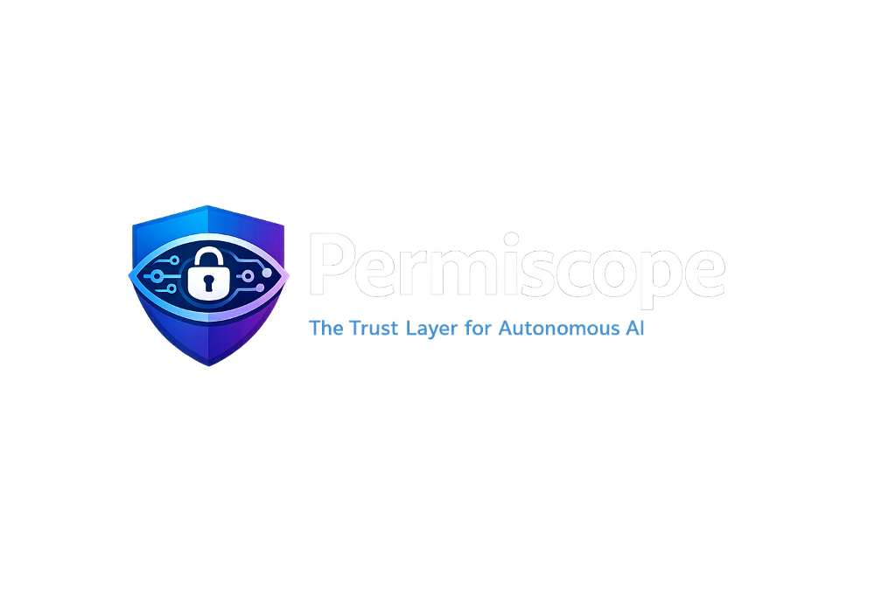

<div align="center">
  
  <h1>Permiscope</h1>
  <p><b>The Trust Layer for Autonomous AI Agents</b></p>

  <p>
    
    
    
  </p>
</div>

---

### 🛡️ Secure. 📜 Auditable. 🙋 Human-Driven.

**Permiscope** is an open-source infrastructure layer that mediates the real-world actions of autonomous AI agents. Think of it as **verified principals + policy engine + audit trail** for AI agents.

> [!IMPORTANT]
> Permiscope is **cooperative governance, not a sandbox** ([ADR-0001](./docs/adr/0001-cooperative-governance-boundary.md)). It governs actions that flow through its API; it does not intercept direct `fs` calls or processes spawned outside the gateway. Use OS-level isolation for fully adversarial agents.

## 🚀 Why Permiscope?

Without mediation, agents operate with full system permissions — a single bug or an injected instruction can cause catastrophic damage. Permiscope enforces **least privilege, human oversight, and auditability** by default, reducing the blast radius of autonomous systems in production.

---

## 🧠 The Problem

The industry has moved beyond “Look what this agent can do” to **“How do I stop this agent from breaking critical systems?”**

Current agent frameworks typically operate with:
*   ❌ All-or-nothing permissions
*   ❌ Minimal oversight
*   ❌ Limited traceability
*   ❌ High operational risk

## 🛡️ The Solution: Mediated Agency

Instead of agents directly accessing files, APIs, or shells, every action flows through Permiscope’s **Secure Execution Gateway**.



Every action passes through the gateway, where principal verification, budgets and policy
decide whether an executor may touch a resource. Signed INTENT and RESULT records bracket
each execution. [Full architecture →](./docs/architecture.md)

## ✨ Key Capabilities

<table width="100%">
  <tr>
    <td width="50%" valign="top">
      <h3>🔐 Granular Control</h3>
      <ul>
        <li><b>Permission Scopes:</b> ALLOW, BLOCK, or REQUIRE_APPROVAL for any action.</li>
        <li><b>Contextual Guardrails:</b> Case-insensitive path restrictions, an <b>executable allowlist</b>, and <b>ReDoS-protected</b> command filtering.</li>
      </ul>
    </td>
    <td width="50%" valign="top">
      <h3>👤 Human-in-the-Loop</h3>
      <ul>
        <li><b>Approval Gateway:</b> Pause sensitive actions for manual review.</li>
        <li><b>Stable Approval Cache:</b> Prevent fatigue with deterministic, session-based caching.</li>
      </ul>
    </td>
  </tr>
  <tr>
    <td width="50%" valign="top">
      <h3>📝 Trust & Transparency</h3>
      <ul>
        <li><b>Tamper-Evident Logs:</b> hash chaining plus HMAC-SHA256 signatures when a signing secret is set.</li>
        <li><b>Dry-Run Mode:</b> Simulate actions to understand results without side effects.</li>
      </ul>
    </td>
    <td width="50%" valign="top">
      <h3>🚀 Advanced Features</h3>
      <ul>
        <li><b>Shadow Mode:</b> Observe what an untrusted agent would do without executing it.</li>
        <li><b>Authenticated Dashboard:</b> Securely manage approvals and monitor logs in real-time.</li>
      </ul>
    </td>
  </tr>
</table>

---

## 🚀 Quick Start
### 📦 Installation

```bash
npm install permiscope
```

> Requires Node.js 24+. The package ships both CommonJS (`require`) and ESM (`import`)
> builds, verified by `npm run check:package`. The Python client is installable from
> a clone with `pip install .`.

### ⚡ 30-Second Quick Start

Get a guided tour of Permiscope in action:
```bash
npx permiscope --demo
```
*This demo showcases allowed, blocked, and human-approved actions in a safe environment.*

---

## 🔐 Security Configuration

Permiscope is designed for high-trust environments. Use these environment variables to harden your installation:

| Variable | Importance | Description |
|----------|------------|-------------|
| `PERMISCOPE_AUDIT_SECRET` | **Critical** | Secret key for HMAC-SHA256 audit log signing. Hosts refuse to start without it (ADR-0020). |
| `PERMISCOPE_AUDIT_KEY_ID` | Medium | Key ID written into entries; change it to rotate keys. |
| `PERMISCOPE_AUDIT_KEY_RING` | Medium | JSON map of key ID → secret so old entries stay verifiable after rotation. |
| `PERMISCOPE_DASHBOARD_TOKEN` | **High** | Bearer token required for every dashboard API route; without it, requests are rejected. |
| `PERMISCOPE_SIDECAR_TOKEN` | **High** | Bearer token required by the language-agnostic HTTP sidecar. |
| `PERMISCOPE_STRICT_LOGGING` | Medium | Set to `true` to block actions if the audit log cannot be written. Hosts enable this. |
| `PERMISCOPE_DASHBOARD_ALLOW_ANONYMOUS` | Dev only | Explicit opt-out of dashboard authentication for local development. |
| `PERMISCOPE_ALLOW_UNSIGNED_AUDIT` | Dev only | Disables the host signing requirement for local development; strict logging stays on. |

### 🧪 Security evaluation

A versioned corpus of adversarial actions (shell injection, command allowlist escape,
path escape, approval identity, default deny) is run on every CI job. Current result:
**56/56 passed (100%)** for corpus v1.1.0. Reproduce it locally with:

```bash
npm run eval
```

See [`eval/cases.json`](./eval/cases.json) for the cases and
[`eval/fixtures/rogue-agent.json`](./eval/fixtures/rogue-agent.json) for a recorded
end-to-end scenario with a verified signed audit chain. Regenerate both the scenario and
the public demo data with `npm run eval:fixture && npm run fixture:web`.

---

### 🛠️ Execution & CLI

Permiscope allows you to wrap agent commands safely:

- **✅ Allowed Action:**
  ```bash
  permiscope run_command "echo hello"
  ```
- **❌ Blocked Action (Dangerous):**
  ```bash
  permiscope run_command "rm -rf /"
  ```

### 💻 Web Dashboard

> [!IMPORTANT]
> In production, always set `PERMISCOPE_DASHBOARD_TOKEN` for the control plane.

1. **Start the Control Plane:**
   ```bash
   # From within the repository
   npm run dev:dashboard
   ```
2. **Access the Interface:** Open [http://localhost:3000](http://localhost:3000) to review approvals and live audit trails.

The React governance console adds an eval scoreboard, chain verification panel, and
a reconstructed rogue-agent scenario. Run it locally with `npm run dev:web`.

**[Live demo →](https://shubhusion.github.io/Permiscope/)** — read-only, fixture-backed,
deployed on every push to `main`. See [hosting docs](./docs/hosting.md) for local and
Cloudflare Pages setup.

---

## 🎯 Framework Agnostic by Design

> **Permiscope doesn't create agents — it governs what they can do.**

Permiscope is a **trust layer**, not an agent framework. It wraps your existing execution logic with policy enforcement, approvals, and audit logging. Works with:

- LangChain / LangGraph
- CrewAI
- Custom agent loops
- Scripts and automations
- Any Node.js/TypeScript code

---

## 🏗️ Integration Guide

### Primary API: PermiscopeAdapter

```typescript
import { PermiscopeAdapter } from 'permiscope';

// Create a trust layer with default policy
const permiscope = new PermiscopeAdapter();

// Execute actions through the governed gateway
const content = await permiscope.act('read_file', { path: 'config.json' });
```

### Wrapping Your Agent's Execution

Use `wrap()` to govern any function:

```typescript
import { PermiscopeAdapter } from 'permiscope';
import * as fs from 'fs';

const permiscope = new PermiscopeAdapter({ policy: myPolicy });

// Wrap your existing executor
const safeReadFile = permiscope.wrap('read_file', async (params) => {
  return fs.readFileSync(params.path, 'utf-8');
});

// Now your function is governed
const content = await safeReadFile({ path: 'config.json' });
```

### One-Liner Utility: withPermiscope

```typescript
import { withPermiscope } from 'permiscope';

// Create a governed function in one line
const safeDelete = withPermiscope('delete_file', async (params) => {
  fs.unlinkSync(params.path);
}, { policy: strictPolicy });

await safeDelete({ path: '/tmp/temp.txt' });
```

### Custom Policy Example

```typescript
import { PermiscopeAdapter, defaultPolicy } from 'permiscope';

const permiscope = new PermiscopeAdapter({
  policy: {
    scopes: [
      ...defaultPolicy.scopes,
      { actionName: 'call_api', decision: 'REQUIRE_APPROVAL' }
    ]
  }
});
```

---

## 🔌 Integration Examples

### With a Custom Agent Loop

```typescript
import { PermiscopeAdapter } from 'permiscope';

const permiscope = new PermiscopeAdapter();

async function agentStep(action: string, params: Record<string, any>) {
  // All actions go through the trust layer
  return permiscope.act(action, params);
}

// Your agent loop
while (hasMoreWork) {
  const nextAction = await agent.plan();
  const result = await agentStep(nextAction.name, nextAction.params);
  await agent.observe(result);
}
```

### With LangChain Tools (Conceptual)

```typescript
import { PermiscopeAdapter, withPermiscope } from 'permiscope';

// Wrap LangChain tool executors
const safeShellTool = withPermiscope('run_command', async (params) => {
  return shellTool.call(params.command);
});

// Use in your chain
const tools = [safeShellTool, safeFileTool];
```

---

## 🔌 Framework Integrations

Permiscope works with any agent framework or custom workflow.

| Framework | Pattern | Demo |
|-----------|---------|------|
| **LangChain** | Wrap Tool Executors | [langchain.ts](./examples/integrations/langchain.ts) |
| **CrewAI** | Multi-Agent Governance | [crewai.ts](./examples/integrations/crewai.ts) |
| **Custom Loops** | Mediated `act()` calls | [custom-loop.ts](./examples/integrations/custom-loop.ts) |
| **Workflows** | Functional `wrap()` | [workflow-runner.ts](./examples/integrations/workflow-runner.ts) |

**Learn more in the [Integrations Guide](./docs/integrations.md).**

---

## 🧪 Real-World Scenarios

Check out `src/scenarios/` for full demos:
1. **DevOps Agent**: Safely edits configs, blocked from restarting services.
2. **Data Agent**: Reads raw data, writes processed output, blocked from overwriting raw.

---

## 📚 Documentation

See the [`/docs`](./docs) folder for detailed guides:

- [Architecture](./docs/architecture.md) — System design and trust boundaries
- [Security Model](./docs/security-model.md) — Threat model and guarantees
- [Policy Engine](./docs/policy-engine.md) — Rule evaluation and guardrails
- [Approvals Workflow](./docs/approvals-workflow.md) — Human-in-the-loop
- [Custom Executors](./docs/custom-executors.md) — Extending Permiscope
- [Hosting the demo](./docs/hosting.md) — Local console and static deployment
- [Architecture post](./docs/architecture-post.md) — Decisions, threat model and limits
- [FAQ](./docs/faq.md) — Common questions
- [End-to-end validation](./docs/e2e.md) — Live process checks and manual checklist
- [Performance](./docs/performance.md) — Bench script and measured overhead
- [Migration guide](./docs/migration.md) — Upgrading and compatibility policy
- [Release procedure](./docs/releases.md) — Branching, tagging and publishing
- [Architecture decisions](./docs/adr/README.md) — Why the design is the way it is
- [Roadmap](./ROADMAP.md) — Shipped work and what comes next
- [Security policy](./SECURITY.md) — Supported versions and private reporting

---

## 🤝 Contributing

We welcome community contributions! Permiscope uses structured templates for **Bug Reports**, **Feature Requests**, and **Pull Requests**.

1. Open or claim an issue before starting work.
2. Fork the repository and create a branch for that issue.
3. Follow the [Contributing Guidelines](CONTRIBUTING.md) and [Maintainer Rules](MAINTAINING.md).
4. Open a PR with our standardized template and link the issue with `Closes #N`.

Everyone participating is expected to follow the [Code of Conduct](CODE_OF_CONDUCT.md).

## 📄 License

MIT License. See `LICENSE` for more information.
