# Execution Gateway

The `ExecutionGateway` is the central orchestrator for policy evaluation, approval
handling, execution and audit logging.

## Construction

```typescript
import { ExecutionGateway, PolicyEngine } from 'permiscope';

const engine = new PolicyEngine(policy);
const gateway = new ExecutionGateway(
  engine,
  { call_api: async (params) => fetch(params.url).then((r) => r.text()) },
  { defaultPrincipalId: 'my-service', shadowMode: false },
);

const result = await gateway.run(action);        // execute
const decision = await gateway.decide(action);   // preview, no side effect
```

The three arguments are the policy engine, a map of custom executors keyed by action name,
and `GatewayOptions`. There is no `registerExecutor()` method — add executors to the map
when constructing the gateway (or use `PermiscopeAdapter.customExecutors`).

## Governed call sequence



Principal verification, budget state and policy evaluation are shared by `decide()` and
`run()`. A decide call records a budget attempt but never reserves an execution.

## Gateway options

```typescript
interface GatewayOptions {
  defaultPrincipalId?: string;
  principalProvider?: (action: Action) => Principal | Promise<Principal>;
  approver?: (request: ApprovalRequest) => Promise<boolean>;
  approvalTimeoutMs?: number;
  approvalPollIntervalMs?: number;
  approvalCache?: ApprovalCache;
  auditLogger?: AuditLogger;
  budget?: Budget;
  budgetTracker?: BudgetTracker;
  shadowMode?: boolean; // host-only; actions cannot request it
}
```

## Built-in executors

| Action | Behavior |
|--------|----------|
| `read_file` | `fs.promises.readFile(path, 'utf-8')` |
| `write_file` | `fs.promises.writeFile(path, content, 'utf-8')` |
| `run_command` | `shell-quote` AST tokenization, then `spawn(argv, { shell: false })` with a timeout and output cap |

File paths are re-resolved to a canonical path immediately before I/O and must remain
inside the scope's `allowedPaths`. Commands containing shell operators, nested shells or
`$`/backtick substitution are rejected.

## Custom executors

```typescript
const gateway = new ExecutionGateway(engine, {
  call_api: async (params) => {
    const response = await fetch(params.url, { method: params.method ?? 'GET' });
    if (!response.ok) throw new Error(`HTTP ${response.status}`);
    return response.text();
  },
});
```

An executor receives the action's `parameters` and returns the output value directly;
throw to fail the action. See [custom executors](./custom-executors.md) for more examples.

## Result structure

```typescript
interface GatewayResult {
  decision: 'ALLOW' | 'BLOCK' | 'REQUIRE_APPROVAL' | 'SHADOW_BLOCK';
  success: boolean;
  sideEffects?: 'none' | 'committed';
  output?: any;
  error?: string;
  reasonCode?: string;
  matchedScope?: string;
  remediation?: string;
  budgetRemaining?: { calls: number | null; spend: number | null };
  compensated?: boolean;
  replayed?: boolean;
}
```

`sideEffects: 'committed'` means the executor ran — even when a postcondition later failed.
Postconditions detect violations; they do not roll back committed effects.

## Two-phase audit

Before any side effect the gateway writes a signed `INTENT` record (decision, principal and
`intentHash`). In strict logging mode a failure here blocks execution. After execution it
appends a `RESULT` record with the same hash. Execution output and errors are redacted in
the log unless explicitly allowlisted via `AuditLoggerOptions.allowedOutputKeys`.

## Shadow mode

Shadow mode is host configuration, not a caller-controlled action field:

```typescript
const gateway = new ExecutionGateway(engine, {}, { shadowMode: true });
```

A blocked action appears to succeed with `[SHADOW] Action appeared successful.` and is
recorded as `SHADOW_BLOCK`; no executor runs.

## Error handling

| Error | Behavior |
|-------|----------|
| Executor throws | `success: false`, error returned and recorded |
| Policy error or unsafe regex | `BLOCK` (fail closed) |
| Approval timeout / rejection | `BLOCK` (fail closed) |
| Budget exhausted | `BLOCK` with `BUDGET_EXCEEDED` |
| INTENT log fails (strict) | action blocked before execution |
| RESULT log fails (strict) | action already ran; error says the result could not be recorded |
